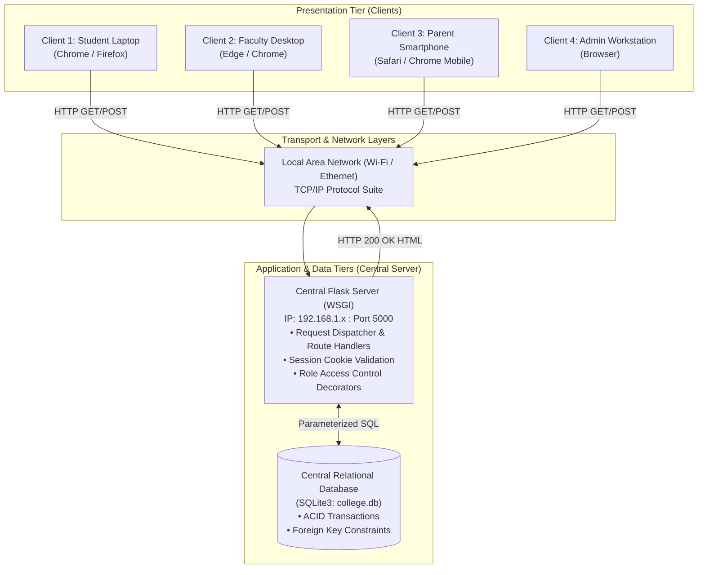
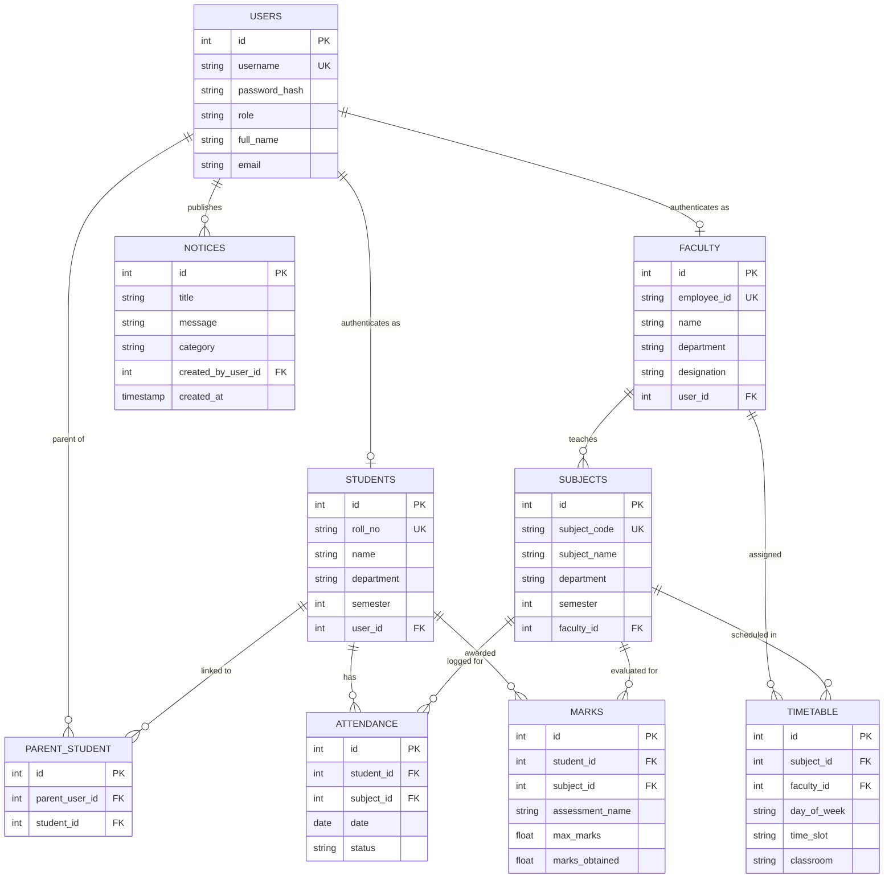

# ACADEMIC PROJECT REPORT
## Educational (College) Management System
### A Computer Network Based Client–Server Management System
**Course:** ECT423 Computer Networks  
**Student Name:** Adwaith R.  
**Architecture:** Multi-Tier Client–Server Model over TCP/IP  

---

## 1. Introduction & Problem Statement

In traditional academic institutions, administrative and academic data—including student records, subject registrations, daily attendance logs, internal assessment marks, and departmental circulars—are often isolated across separate physical offices or department-specific computer systems.

### Identified Challenges:
- **Data Fragmentation:** Student data and attendance exist in disparate logbooks or isolated departmental machines.
- **Manual Delays:** Communication of circulars and marks from faculty to students and parents requires physical notice boards or delayed manual entry.
- **Security & Authorization Risks:** Without role-based access control, confidential exam marks or student contact details can be inadvertently exposed.
- **Lack of Real-Time Consistency:** Updates made in one office are not immediately visible to parents or students.

### Proposed Solution:
To overcome these challenges, this project implements a centralized, multi-user **Client–Server Educational Management System**. Operating over a Local Area Network (LAN) using standard TCP/IP and HTTP protocols, all college stakeholders (Students, Faculty, Parents, and Administrators) interact with a single central server managing an authoritative relational database.

---

## 2. Project Objectives

1. Demonstrate core **Computer Networks** concepts including:
   - Client–Server Architecture.
   - TCP/IP transport protocol and HTTP request–response model.
   - Socket binding on `0.0.0.0:5000` to support multi-client LAN communication.
   - Maintaining stateful authenticated sessions over stateless HTTP.
2. Build an intuitive, responsive web portal with role-based segregation:
   - **Student Portal:** Attendance tracking, marks statement, timetable, and campus notices.
   - **Faculty Portal:** Daily attendance submission, internal assessment marks entry, teaching schedule, and academic notice publishing.
   - **Parent Portal:** Dedicated window to view their linked ward's attendance, examination scores, and college circulars.
   - **Administrator Console:** Comprehensive student/faculty account enrollment, subject curriculum management, master timetable scheduling, and institutional compliance reporting.
3. Guarantee database integrity and security using foreign key constraints and cryptographic password hashing (PBKDF2 SHA-256).

---

## 3. Computer Network Architecture & Protocols

The system follows a three-tier client–server architecture:

### Protocol Stack Breakdown:
- **Application Layer (HTTP/1.1):** 
  - Standard methods: `GET` for retrieving dashboards and records; `POST` for submitting forms (login credentials, student registrations, attendance, and marks).
  - Status codes: `200 OK` (successful retrieval), `302 Found` (redirect after action), `403 Forbidden` (role authorization failure), `404 Not Found` (invalid URI).
- **Transport Layer (TCP):** 
  - Reliable, full-duplex, connection-oriented data transfer.
  - Three-way handshake (`SYN` -> `SYN-ACK` -> `ACK`) precedes HTTP message exchange.
  - Byte-stream sequence numbers ensure in-order delivery of HTML pages and CSS stylesheets.
- **Network Layer (IPv4):** 
  - Host machines are identified by their unique 32-bit IPv4 address assigned by the local router's DHCP server.
  - Server listens on wildcard address `0.0.0.0`, binding to all network interfaces on port `5000`.

---

## 4. Database Design & Entity-Relationship (ER) Diagram

The central database consists of 9 normalized relational tables:

---

## 5. Security & Reliability Highlights

1. **Password Hashing:** Passwords are never stored in plain text. The application uses Werkzeug's `generate_password_hash` implementation (PBKDF2 SHA-256 with random salt).
2. **SQL Injection Defense:** All database interactions utilize parameterized SQL queries (`?` placeholders) executed via `cur.execute(query, args)`. Direct string concatenation into SQL commands is strictly avoided.
3. **Server-Side Access Control (Least Privilege):** 
   - Role verification is enforced using Python function decorators (`@role_required`). Even if a student manually enters `/admin/dashboard` in their browser, the server intercepts the request and issues a `403 Access Denied` response.
4. **Relational Parent-Ward Isolation:** A parent account cannot see any student's data except the specific ward mapped in the `parent_student` relational junction table.

---

## 6. Testing & Demonstration Results

### Automated Unit & Route Test Suite
An automated test suite (`test_full_suite.py`) was executed against the running application:
- `test_01_login_page_renders`: Verified HTTP `200` and login markup delivery.
- `test_02_invalid_login`: Verified authentication rejection and failure notification.
- `test_03_admin_workflow`: Verified admin authentication and access to all 6 admin management routes.
- `test_04_faculty_workflow`: Verified attendance entry, marks entry, and notice broadcasting.
- `test_05_student_workflow`: Verified student dashboard metrics and unauthorized route blocking.
- `test_06_parent_workflow`: Verified parent linkage access control and ward data retrieval.
- **Result:** `6 / 6 tests passed (Ran 6 tests in 0.570s, OK)`.

### Local Network Multi-Client Demonstration
1. The host laptop ran `app.py` bound to IP `192.168.1.45:5000`.
2. A smartphone connected to the same Wi-Fi access point opened `http://192.168.1.45:5000`.
3. The smartphone logged in as `parent_adwaith` while the host laptop logged in as `prof_smith`.
4. Marking attendance on the laptop immediately updated the attendance percentage displayed on the smartphone upon page reload, confirming real-time centralized synchronization over LAN.

---

## 7. Viva & Oral Evaluation Questions

**Q1: Why is HTTP called a stateless protocol, and how does your project maintain login state?**  
*Answer:* HTTP is stateless because each request from a client to a server is treated as an independent transaction without memory of previous requests. To maintain login state, our Flask server issues a cryptographically signed session cookie upon successful authentication. On subsequent requests, the client's browser sends this cookie in the HTTP `Cookie` header, allowing the server to look up the active session.

**Q2: Why did you bind the server to `0.0.0.0` instead of `127.0.0.1`?**  
*Answer:* `127.0.0.1` is the loopback interface, meaning the server only accepts connections originating from the same physical machine. `0.0.0.0` tells the operating system's TCP stack to listen on all available network adapters (including the Wi-Fi adapter), making the server reachable by other client devices across the LAN.

**Q3: How does the server prevent SQL Injection?**  
*Answer:* By using parameterized queries (`?` place-markers in SQLite). The SQL engine parses the query structure first, and user input is treated strictly as data literals rather than executable SQL syntax.

**Q4: Where does TCP operate in this application?**  
*Answer:* TCP operates at Layer 4 (Transport Layer). When a client browser initiates an HTTP connection to port 5000, TCP performs a three-way handshake (`SYN`, `SYN-ACK`, `ACK`), handles segment retransmission in case of packet loss, and guarantees reliable, ordered byte delivery.

---

## 8. Limitations & Future Scope

### Current Limitations:
- The development server uses HTTP (unencrypted) rather than HTTPS/TLS.
- SQLite is single-writer file-based, suitable for college project scale but limited for tens of thousands of concurrent writers.

### Future Scope:
1. **Transport Layer Security (TLS/HTTPS):** Install an SSL/TLS certificate to encrypt network packets against eavesdropping.
2. **Production WSGI Server:** Deploy using Gunicorn or uWSGI behind an Nginx reverse proxy.
3. **Database Migration:** Transition to PostgreSQL or MySQL for enterprise-scale concurrent write workloads.
4. **Automated Notification Triggers:** Implement WebSockets for real-time instant alerts when attendance or marks are submitted.

---

## 9. Conclusion

The developed **College Educational Management System** successfully achieves all academic objectives outlined in the Computer Networks syllabus. By integrating a clean Bootstrap 5 client interface with a centralized Python Flask server and SQLite database, the project concretely demonstrates client–server interaction, TCP/IP communication, role-based access security, and relational database integrity in a practical, real-world educational environment.

